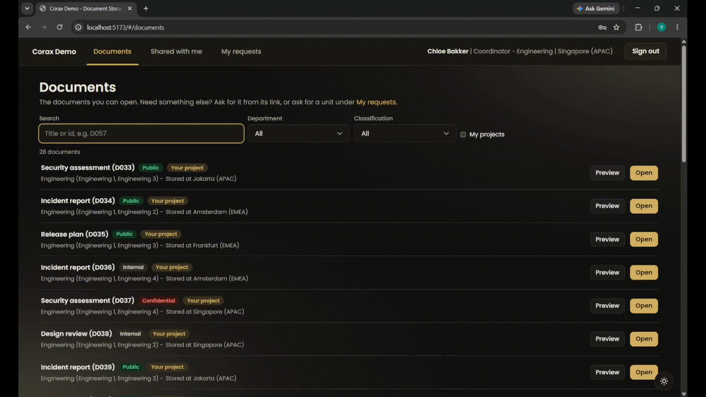
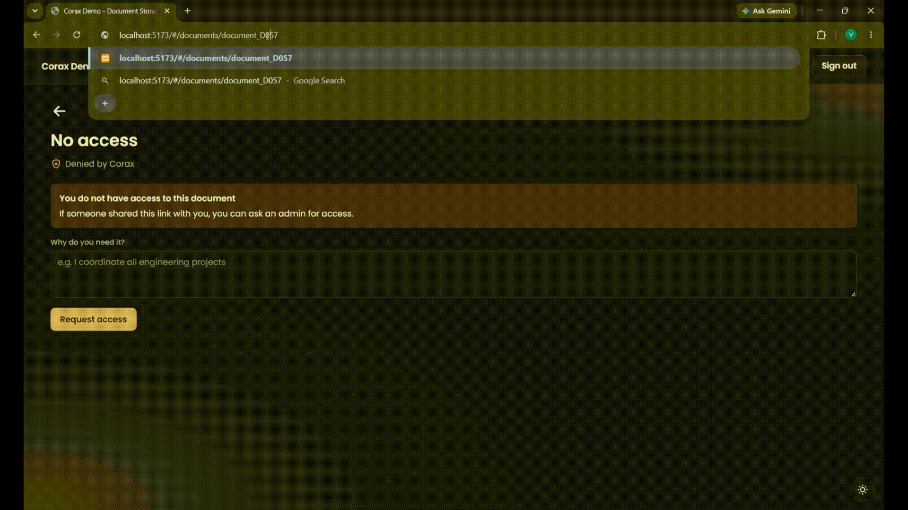
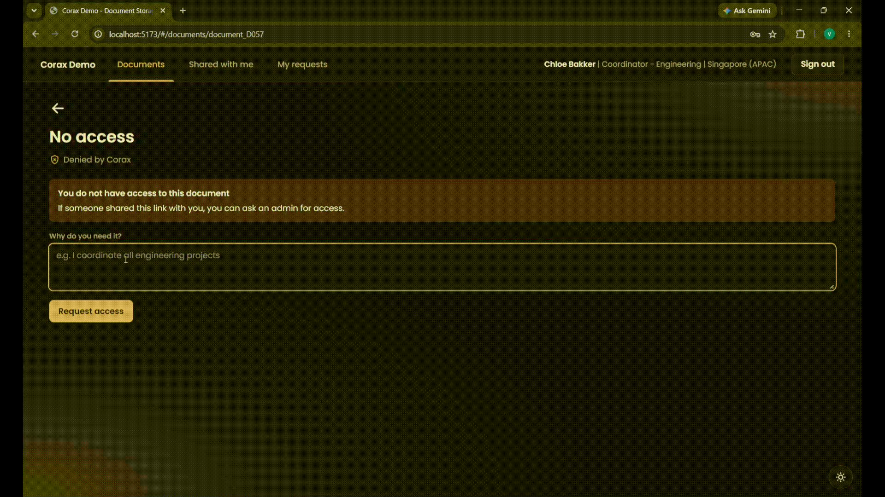
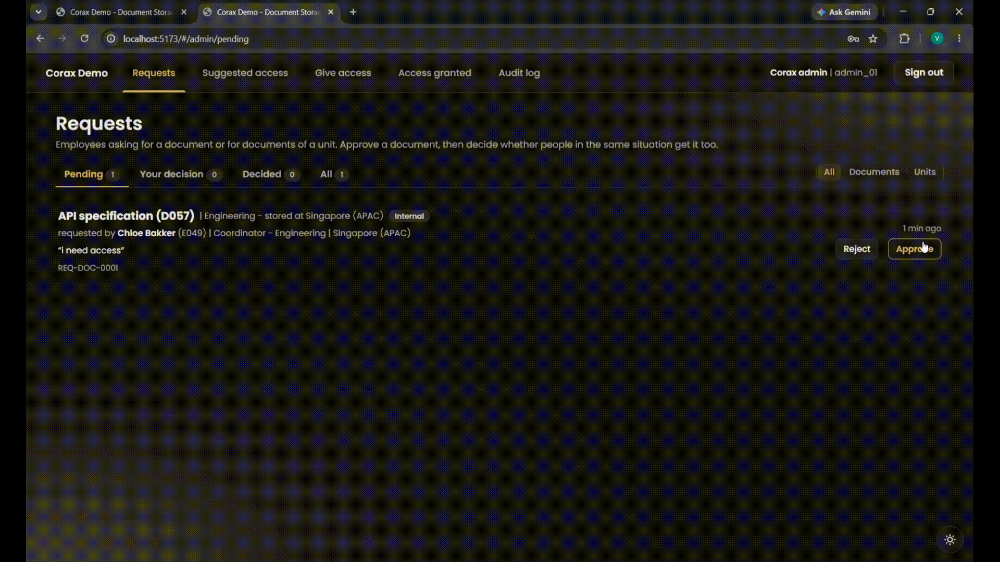
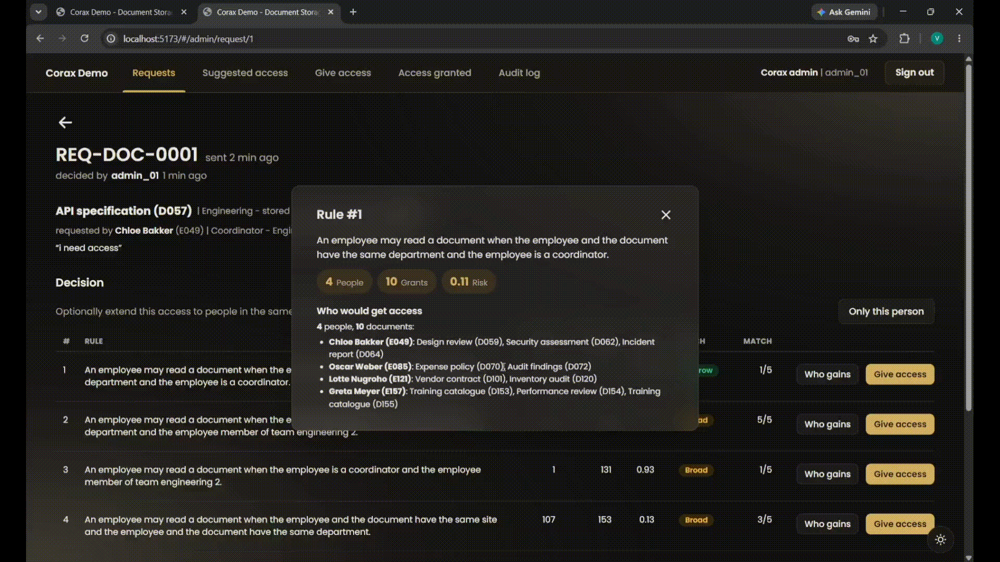
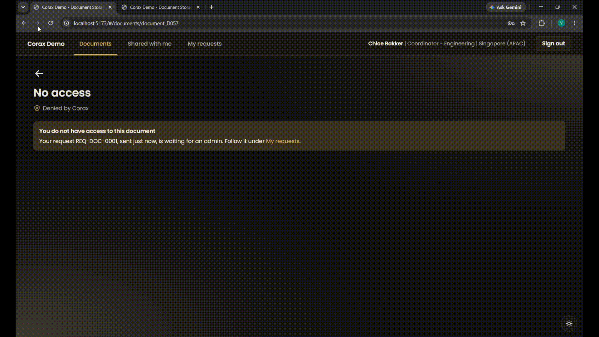
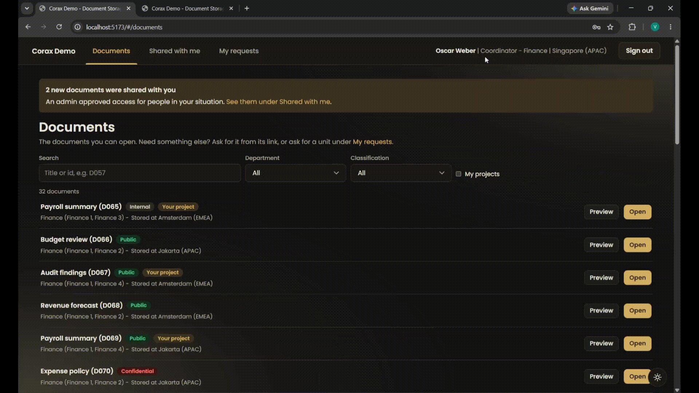

<h1 align="center">Corax: Adaptive Access Control for APIs</h1>

<p align="center">
  
</p>

<p align="center">
  <a href="LICENSE"></a>
  
</p>

<div align="justify">
  Corax is an open-source access control system for web APIs. It decides who may open what inside an organization, combining the rules the organization writes with an AI model that learns how people actually work. <br>
  Most organizations rely on fixed rules to manage access. While these rules define who can access which resource, they don't always reflect how people actually work. This can lead to unusual access requests going unnoticed or legitimate requests being blocked simply because existing policies don't anticipate these situations. <br>
  Corax adds another layer of analysis to access control. Beyond checking whether a request is permitted by existing policies, it examines whether the request aligns with what users in similar roles and situations typically access. This helps identify unusual access patterns that traditional rules might miss.

  ## Demo

  **The scenario:**<br> A company keeps 160 documents in a shared document application, used by 180 employees across 5 departments. People may open the documents of the projects they work on, and the
  public documents of their own department. Chloe coordinates every engineering project, but she is not a member
  of each one, so the rules keep some engineering documents from her. Oscar coordinates Finance and has the same
  problem, although he has not noticed yet.

  

  **1. Every request is checked:** Chloe tries to access an engineering document outside her projects, but her request is denied, preventing her from accessing the document entirely. Even when existing policies allow a request, Corax takes another look to see whether the access aligns with how people in similar roles typically work. If the request seems unusual, Corax blocks it before access is granted.

  

  **2. She asks, with a reason:** Chloe writes why she needs the document. The request goes to an administrator, and she can follow it under "My requests".

  

  **3. One approval, and a suggestion for everyone like her:** Once the administrator approves the request, Chloe can access the document right away. Corax then recommends policy updates that could extend the same access to others in similar situations, presenting options from the most specific to the broadest. For example, one suggested rule might allow coordinators to read documents belonging to their own department. Each recommendation also shows who would gain access, which documents they could access, and how unusual that access would be.

  

  **4. The rule reaches the right people:** The administrator selects the coordinator rule, which affects only a small group of people, so it is applied immediately. Oscar can now access documents from his own department without needing to request permission each time. For rules that would affect a larger group, Corax asks the administrator to review and confirm the change before applying it.

  

  

  **5. Every decision is recorded and can be reversed:** The audit log keeps track of who approved each change and the data behind the recommended rule's scope. It also records who accessed resources through the new rule and when. If a rule no longer fits the organization's needs or turns out to be inappropriate, the administrator can revoke it and immediately remove the access it granted.

  

  Chloe and Oscar are real accounts of the demo, `e049` and `e085`. The full walkthrough is in [Demo Docs](docs/demo.md).

  ## Why Corax?

  Access mistakes are the most common security flaw in web APIs. Broken Object Level Authorization, where a person reaches data that belongs to someone else. It keeps happening because most applications never keep their access rules in one place. Each part of the system writes its own checks, nobody can review them all, and when the organization changes, the checks
  quietly drift apart.

  Corax brings all access rules together in one place and ensures they are enforced consistently across every service. It also adds two capabilities that traditional access control rules cannot provide on their own:

  - **A second layer of review for every allowed request:** A model trained on actual user activity looks for access requests that are technically permitted but unusual for the person making them. It can only deny access, ensuring that it cannot give users permissions beyond what existing policies allow.

  - **Policies that adapt as needs change:** When an administrator approves an exception, Corax uses that decision to recommend a new rule for others in similar situations. This helps address recurring access needs without requiring each person to submit the same request.

  ## What Corax does

  - **Blocks unusual access** that the fixed rules would have allowed.
  - **Turns approvals into rules**, from the narrowest to the broadest, and shows who each rule would reach before it applies.
  - **Asks for a second confirmation** when a rule would reach many people or look unusual.
  - **Checks every generated rule** against the application's own tests before it takes effect.
  - **Takes access back in one click**, and records who did it.
  - **Points at access people probably need** but nobody granted yet, for an administrator to review.
  - **Keeps a full audit trail** of every approval, rule and revoke, and of every time that access was used.
  - **Fits any application** that can describe its people, data and relationships in two CSV files.

  ## Results

  Tested on public data, with every number reproducible from the repository.

  | What we measured | Data | Result |
  |---|---|---|
  | Legitimate requests wrongly blocked | [Amazon Access Samples](https://archive.ics.uci.edu/dataset/216/amazon+access+samples): 36,063 employees, 595,506 accesses | **0.94%**, fewer than 1 in 100 |
  | Telling real access from unusual access (AUC, 1.0 is perfect) | Same data | **0.985** against random access, **0.897** against access a colleague has |
  | Finding the right rule from a single approval | [Xu & Stoller ABAC policies](https://www3.cs.stonybrook.edu/%7Estoller/software): 45 hidden rules | **Ranked first for 26**, in the top 5 for 37 |
  | Same, on rules inferred from Amazon | 10 hidden rules | **In the top 2 for all 10** |

  How each number was measured is in [AI model and evaluation](docs/ai-model-and-evaluation.md#evaluation).

  ## Technical Overview
  ### The building blocks

  - **OPA (Open Policy Agent)** is an open-source policy engine that evaluates access requests and determines whether they should be allowed or denied. It is a graduated project of the Cloud Native Computing Foundation (CNCF) and is widely used for policy enforcement.
  - **Rego** is the policy language used to write rules in OPA.
  - **ABAC and ReBAC** are two access control models supported by Corax. Attribute-Based Access Control (ABAC) makes decisions based on attributes such as a user's role, department, or a resource's classification. Relationship-Based Access Control (ReBAC), on the other hand, considers how users and resources are connected, such as who is assigned to a project or who reports to whom.
  - **Envoy** is a widely used proxy that sits between users and applications, forwarding requests from users to the services they want to access.

  ### 2 ways to plug Corax in

  Corax can be deployed in 2 ways, and the demo uses both:

  - **As a sidecar:** A sidecar runs alongside an application and handles tasks that would otherwise need to be built into the application itself. In this setup, Envoy sits in front of the API and checks every incoming request with OPA before forwarding it to the application. This means the application does not need to handle access checks on its own.
  - **As a policy decision point (PDP):** In this approach, OPA makes the access decision, while the application remains responsible for enforcing it. The application sends OPA a request asking whether a user is allowed to perform a particular action, then follows the decision it receives. In the demo, the document application uses this approach to show users only the documents they are allowed to access.

  ### How the Corax AI fits in

  When the rules allow a request, OPA asks the Corax service for a risk score. The score comes from a graph neural
  network, a model that learns from the network of user, resources and how they are connected. Corax uses a
  heterogeneous GraphSAGE model, an implementation of the method of [Yin et al. (2024)](docs/references.md).

  | Layer | Role | Can it grant access? |
  |---|---|---|
  | Rules (OPA, written in Rego) | Final authority, the same answer every time | Yes |
  | AI risk check | Flags requests that passed the rules but do not fit how people actually work | No |
  | Appeals | Turns an administrator's decision into a new rule | Only through a validated rule. Broad rules need a second confirmation |

  - **Deny-only AI:** A request is allowed only when the rules allow it and the AI does not find it risky. The AI can block a request the rules allow, but it cannot grant access the rules deny.
  - **Appeals that generalize:** The model represents each user and document as an embedding, placing similar ones closer together. When an appeal is approved, Corax uses the most similar cases to identify patterns and suggest new policy rules based on the requesting user's attributes and circumstances.
  - **Rule Impact Assessment:** Corax evaluates how many people and resources a new rule would affect, how much additional access it would provide, and how unusual that access would be. Based on this assessment, Corax determines whether the rule can be applied immediately or requires an additional confirmation from the administrator.
  - **Validated Policy Code (Rego):** Every generated rule is checked for syntax, uses only allowed attributes, passes the
    application's own tests, and must grant exactly what the administrator approved.
  - **Live reload, instant revoke:** Each rule is its own `.rego` file. OPA loads a new one within milliseconds without a restart, and revoking deletes the file.

  ## Quick Start

  All you need is Docker. From the repository root:

  ```bash
  docker compose -f deploy/docker-compose.yml run --rm prepare
  docker compose -f deploy/docker-compose.yml up -d --build
  ```

  The first command generates the demo company and trains the model, which takes a few minutes the first time. The second starts the gateway, the policy engine, the Corax service and the document app.

  Then open http://localhost:8080 and sign in as Chloe (`e049`) or the administrator (`admin_01`). The sign-in page
  lists the demo accounts, and [running the demo](docs/demo.md) walks through every scenario. The requirements and
  the full setup are in [Getting Started](docs/getting-started.md).

  Without Docker, the same company and model can be explored from Python, without the web app. See
  [Demo without Docker](docs/scripts.md#the-demo-company-without-docker).

  ## Documentation

  The full documentation is also on [GitBook](https://corax.gitbook.io/documentation).

  | # | Page | What it covers |
  |---|---|---|
  | 1 | [Getting started](docs/getting-started.md) | Requirements, the folders, and deployment |
  | 2 | [Running the demo](docs/demo.md) | A guided tour of the document app |
  | 3 | [Architecture](docs/architecture.md) | The request path, the service API, the policy and security |
  | 4 | [AI model and evaluation](docs/ai-model-and-evaluation.md) | How the model works, and how the numbers above were measured |
  | 5 | [Scripts](docs/scripts.md) | Preparing data, training the model, and the demo scripts |
  | 6 | [References](docs/references.md) | The research Corax builds on |
  
  Changes between versions are listed in the [changelog](CHANGELOG.md).

  ## License

  Released under the [Apache License 2.0](LICENSE).

  ## Author
  - [AgileOrc](https://github.com/AgileOrc)
  ## Contributor
  - [Imkungoingglitch](https://github.com/Imkungoingglitch)
  - [waarsss](https://github.com/waarsss)
</div>
