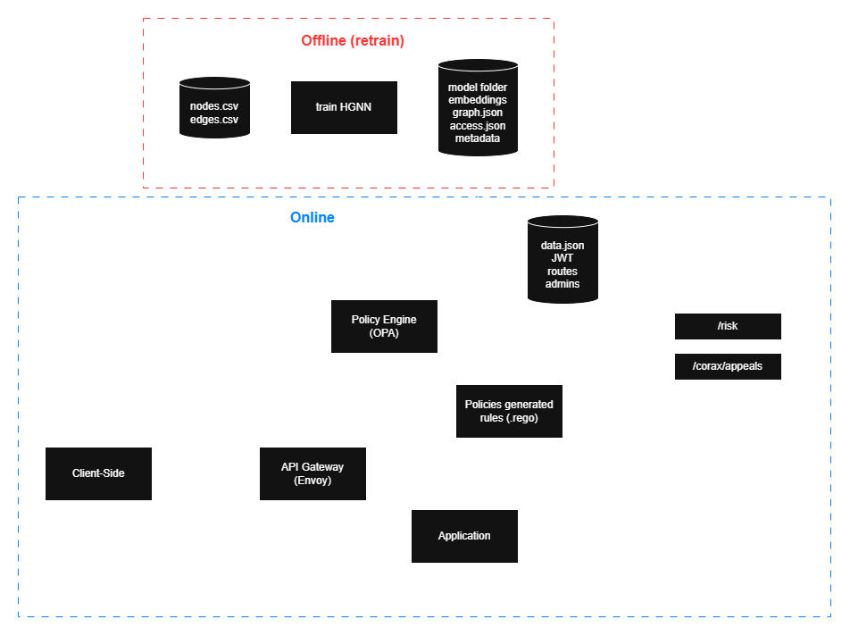
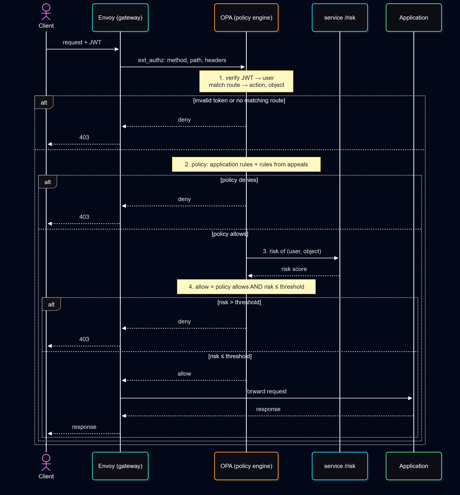

# Architecture

Corax sits in front of an application and decides every request to it. It has an online part, which
handles requests and appeals, and an offline part, which trains the graph model the online part reads.

Three principles shape it, detailed under [Security](#security). Policy code is the only source of allow
decisions, the AI can only turn an allow into a deny, and every rule from an appeal is validated, logged
with who gained access and how that access is used, and revoked by deleting its file.

## Components



| Component | Does | Reads | Writes | Reachable from |
|---|---|---|---|---|
| Envoy | Proxy in front of the application, asks OPA about every request (`ext_authz`) | | | Clients |
| OPA | Policy engine: JWT, route, policy, AI risk call | `policy/`, the application's rules, `policies/generated/`, `data.json`, `graph.json` | | Envoy only |
| `service` | `/risk` and `/usage` for OPA, `/corax/*` for admins and users | Model folder, `data.json` | `policies/generated/`, appeal records, access snapshots, usage logs | OPA and Envoy only |
| `hgnn` | Offline job: trains the model and exports it (`python -m hgnn`) | `nodes.csv`, `edges.csv` | Model folder | Nobody |

## Request path



1. **Identity and route:** OPA verifies the JWT (the user is its `sub`) and matches the method and path to a route. The object id comes only from the URL path, never from the query string or body.
2. **Policy:** The application's rules and the rules from appeals decide. A deny ends here with 403.
3. **Risk check:** Only after an allow, OPA asks the service for the risk of this (user, object) pair. Read [risk score](ai-model-and-evaluation.md#risk-score).
4. **Decision:** The request goes through unless the risk is above the threshold.

The deny-only rule is written out in Rego, so it can be audited:

```rego
allow if {
	policy_allow
	not ai_high_risk
}
```

Listed admins reach the Corax admin routes without the risk check, and the exact pair an admin approved
in an appeal skips it too. Read [policy](architecture.md#policy).

| Failure | Result |
|---|---|
| Missing, expired or forged token | 403 response code, `missing or invalid token` |
| Method and path match no route | 403 response code, `no matching route` |
| OPA unreachable | Envoy denies everything (`failure_mode_allow: false`) |
| Service down or slower than `ai.timeout` | The policy decision stands, `allowed without AI check` |
| User or object unknown to the model (added after the last training) | The policy decision stands, `allowed without AI check` |

## Data and files

| File | Written by | Read by | Content |
|---|---|---|---|
| `embeddings.npz`, `node_ids.json` | `hgnn` | service | One vector per node |
| `metadata.json` | `hgnn` | service | Settings, metrics, risk threshold |
| `graph.json` | `hgnn` | service, OPA (`data.corax.graph`) | Facts of every node: department, role, … |
| `access.json` | `hgnn` | service | Access history, to skip pairs that already have access |
| `data.json` | Operator | OPA, service | JWT settings, routes, AI address, admin list ([Policy](architecture.md#policy)) |
| `policies/generated/*.rego` | service | OPA | Rules and exceptions from appeals |
| `appeals/*.json` | service | service, admins | Appeal records, access snapshots |
| `appeals/*-usage.jsonl` | service | service, admins | Uses of access granted by appeals |

After retraining, the new model folder replaces the old one. The service reads it on restart, and OPA
needs the new `graph.json` in its data folder.

## Trust boundaries

- **Only Envoy is reachable from outside:** OPA, the service and the application sit on the internal
  network.
- **`/risk` and `/usage` have no authentication:** they must stay reachable by OPA only. `/usage` can
  only add lines to a usage log, never grant access.
- **A user sees only their own access:** `GET /corax/me/access` takes the user from the verified token,
  never from the path, query or headers.
- **Appeals are checked twice:** OPA lets only `config.admin.users` reach `/corax/*`, and the service
  verifies the admin's JWT again with the same key and admin list, so reaching the service directly does not bypass the check.
- **No write API for policies:** Rules reach OPA only as files in a folder the service writes.

## Service API

FastAPI service called by OPA and by admins. It reads the folder written by `hgnn`
(`embeddings.npz`, `node_ids.json`, `metadata.json`) and does not need torch.

| Endpoint | Caller | Does |
|---|---|---|
| `POST /risk` | OPA (`http.send`), only after the policy allowed a request | Returns `risk = 1 − σ(h_user · h_object)` from the HGNN embeddings, and logs the use when the access came from an appeal |
| `POST /usage` | OPA, when an appeal exception allowed a request | Logs the use of the exception, which skips `/risk` |
| `GET /health` | Checks, demo | Model info: target edge type, risk threshold, number of users and objects |
| `POST /corax/appeals` | Admin, through Envoy and OPA | Writes the exact exception at once, returns similar cases and candidate rules, each with its scope and tier. Refused with 409 when the user already has the access. With `dry_run`, writes nothing and returns what the appeal would find |
| `GET /corax/appeals/{id}` | Admin | The appeal record and its history (audit log) |
| `GET /corax/appeals/{id}/candidates/{n}` | Admin | Preview: who would gain access to what if the admin accepted candidate `n`. Nothing is written |
| `POST /corax/appeals/{id}/confirm` | Admin | Writes the rule the admin accepted as a validated rule, or keeps only the exception |
| `POST /corax/appeals/{id}/revoke` | Admin | Deletes the rule (and, if asked, the exception) and records who did it |
| `GET /corax/rules` | Admin | Every rule and exception from an appeal still in effect: who gained access and how it was used, as data and as plain sentences |
| `GET /corax/me/access` | Any user with a valid token | The resources this user can reach through appeals. The user comes only from the token |
| `GET /corax/suggestions?user=&limit=` | Admin | Access the model expects but nobody granted yet, for an admin to review. Nothing is written |
| `POST /corax/rank` | Admin | The objects linked to a node (e.g. a department) that a user cannot reach yet, ranked for that user |

The concepts behind them are in [Risk score](ai-model-and-evaluation.md#risk-score) and [Appeal path](ai-model-and-evaluation.md#appeal-path).

### Run

```
pip install -r service/requirements.txt
CORAX_MODEL_DIR=output/exp-hard50 uvicorn main:app --app-dir service --port 8000
```

| Variable | Default | Meaning |
|---|---|---|
| `CORAX_MODEL_DIR` | `output/hgnn` | Folder written by `hgnn` |
| `AI_RISK_THRESHOLD` | `risk_threshold.value` in `metadata.json` | Optional override |
| `GENERATED_DIR` | `policies/generated` | Where validated Rego files are written (OPA loads it with `--watch`) |
| `APPEALS_DIR` | `appeals` | One JSON record per appeal, with its history |
| `CORAX_CONFIG` | none | The application's `data.json` (the one OPA loads). Its `corax.config.jwt` and `corax.config.admin.users` are used to verify admins. Without it the appeal endpoints return 503 response code |
| `OPA_PATH` | `opa` | OPA binary used to validate generated files |
| `POLICY_DIR` | none | The application's policy folder. Its `opa test` must still pass |
| `OBJECT_IDENTITY` | `false` | Allow "object is <id>" in candidates (objects that are systems, as in the Amazon data) |
| `APPEAL_CANDIDATES` | `8` | How many candidate patterns an appeal returns |
| `APPEAL_SIMILAR_MIN`, `APPEAL_SIMILAR_MAX`, `APPEAL_SIMILAR_MARGIN` | `5`, `30`, `0.03` | The similar cases of an appeal: every case at most the margin less similar than the closest one, at least the minimum and at most the maximum of them. An appeal among many near identical cases gets more of them |
| `APPEAL_RESOURCE_TYPE` | the object type of the model's target edge | The `resource_type` that rules and exceptions from appeals hold for. Set it when the routes name the type differently from the graph |
| `AUTO_APPLY_MAX_USER_SHARE` | `0.4` | Share of all users (0 to 1, e.g. `0.5` = 50%) that may get new access. Above it a rule is "large" |
| `AUTO_APPLY_MAX_PAIRS`, `AUTO_APPLY_MAX_MEAN_RISK` | `50`, `0.5` | New (user, object) pairs and their mean risk. Above either a rule is "large" |

A large rule needs `acknowledge_scope`. No regulation fixes these numbers (ISO 27001, NIST 800-53 and PCI DSS ask that access grants are approved and logged, not for a size limit). Set them to the organization's risk appetite. `AUTO_APPLY_MAX_USER_SHARE=0` makes every rule wait for an admin.

To change a limit, set it in the service's environment. With Docker, in `deploy/docker-compose.yml`
under `service` → `environment`:

```yaml
      AUTO_APPLY_MAX_USER_SHARE: "0.5"
      AUTO_APPLY_MAX_PAIRS: "100"
      AUTO_APPLY_MAX_MEAN_RISK: "0.5"
```

Then recreate the service with `docker compose -f deploy/docker-compose.yml up -d service`. Without Docker:

```bash
AUTO_APPLY_MAX_USER_SHARE=0.5 CORAX_MODEL_DIR=output/dummy uvicorn main:app --app-dir service --port 8000
```

The document app demo sets `AUTO_APPLY_MAX_USER_SHARE` to `0.06` in `deploy/docker-compose.yml`, which is 5 of
its model's 86 employees. Its walkthrough ([docs/demo.md](demo.md)) is written for that limit. With other limits an
appeal may change tier.

Appeals need `graph.json` and `access.json` in the model folder. Without them only `/risk` runs.

### `POST /risk`

```json
{"user": "user_0", "object": "resource_HOST_100", "action": "read"}
```

```json
{"risk": 0.0123, "high_risk": false, "threshold": 0.978, "reason": null}
```

- `high_risk` is true when `risk > threshold`. OPA only reads `high_risk`.
- If the user or object has no embedding, `risk` is `null`, `high_risk` is false and `reason`
  says which one is unknown. The policy decision stands.
- `action` is optional. OPA sends it so a use of access from an appeal is logged for the right rule.
- When the pair was opened by a rule from an appeal and the risk is not high, the request goes through,
  so the service appends it to `appeals/<id>-usage.jsonl`.
- The service has no authentication. It must only be reachable by OPA (internal network).

### `POST /usage`

Same body as `/risk`. OPA calls it only when an appeal exception allowed the request, because exceptions
skip `/risk`. It only writes to the usage log and never changes a decision. Like `/risk`, it has no
authentication and must stay on the internal network.

### Appeals

```
POST /corax/appeals                {"user": "alice", "object": "report_105", "action": "read_report", "reason": "..."}
  → 201 {"id": "appeal-0001", "status": "exception_applied", "neighbours": [...],
         "exception": {"description": "alice may read_report report_105, an exception for this one report only."},
         "candidates": [{"index": 1, "description": "An employee may ...", "pattern": "...", "users": 3, "pairs": 12, ...}, ...]}

GET  /corax/appeals/appeal-0001/candidates/3
  → 200 {"description": "...", "scope": {...}, "affected": {"users": 6, "objects": 45, "by_user": [{"user": "bob", "objects": [...]}, ...]}}

POST /corax/appeals/appeal-0001/confirm   {"candidate": 3, "acknowledge_scope": false}
  → 200 {"status": "rule_applied", "chosen": {"description": "...", "scope": {...}}, "validation": [...]}
  → 409 when the rule is large and acknowledge_scope is false: the description, the scope and the first
        20 users who would gain access are in the response
  → 422 when the rule fails validation (nothing is written)
POST /corax/appeals/appeal-0001/confirm   {"candidate": null}
  → 200 {"status": "exception_only"}

POST /corax/appeals/appeal-0001/revoke    {"exception": false}
  → 200 {"status": "rule_revoked", ...}   (exception: true also removes the appellant's exception)
  → 409 when nothing is active to revoke
```

- `description` is a plain-language sentence built from the same predicates as the Rego file, for the
  admin to read. OPA still enforces the Rego file. `pattern` is the same rule in technical form.
- When access is granted (the exception at once, the rule when the admin accepts it), the service writes
  a snapshot of who gained access to what, in `appeals/<id>-granted.json`. Every later use of that access
  is appended to `appeals/<id>-usage.jsonl`.
- Revoking through the endpoint deletes the file and records who revoked it and when. Deleting the file
  by hand also removes the rule, but it is not recorded, and `GET /corax/rules` flags it.

### What the admin and the user see

`GET /corax/rules` returns one entry per rule or exception still in effect, with a `summary` in plain
language:

```
A lecturer may read the grades of a student when the lecturer and the student have the same program and the lecturer is a head of program.
Approved as a rule by admin_rina on 27 Oct 2026 10:00 UTC.
6 people gained access to 45 students.
Used 1 time by 1 person:
  27 Oct 2026 10:01 UTC  lecturer_head_P2 read the grades of student_P2_14
```

`GET /corax/me/access` returns only the resources, for the user of the token:

```json
{"user": "lecturer_head_P2", "resources": ["student_P2_00", "student_P2_01", "student_P2_04", "student_P2_14", "student_P2_16", "student_P2_19"]}
```

It lists only access from appeals. Access from the application's own rules is not listed.

### Suggested access and ranking a unit

The model was trained to predict access. Besides denying pairs that do not fit, its predictions point at
access a user probably needs but nobody granted. Both endpoints score a pair the same way, by the model's
risk, and how many of the user's 10 most similar users can already reach the object (from the access
history and from appeals). Neither writes anything. An admin gives access through the appeal flow.

```
GET  /corax/suggestions?limit=20
  → 200 [{"user": "bob", "object": "report_210", "risk": 0.08, "peers": {"with_access": 7, "of": 10},
          "description": "7 of the 10 people most like bob can open report_210."}, ...]

POST /corax/rank   {"user": "bob", "relation": "owned_by", "node": "department_finance"}
  → 200 {"objects": [...ranked as above, every object of the unit bob cannot reach yet...],
         "warning": null | "None of the people most like this user can open anything here. ..."}
```

- A pair is suggested when its risk is at most the threshold and at least half of the 10 peers can reach
  the object. Both numbers are design choices, not measured values (`service/suggest.py`).
- `rank` lists every object of the unit, best first, and warns when no peer can reach any of them, because the
  unit may be the wrong one.
- `suggestions` scans every user against every object. Above 2,000,000 pairs it answers 422 and must be
  asked for one user (`?user=`).
- Only admins call them, because the results name objects the user cannot open.

- The exception (`<id>-exception.rego`) is written as soon as the appeal is created, the rule
  (`<id>-rule.rego`) only after the admin accepts one of the proposed rules. Both are validated with opa first and
  written atomically, so OPA never loads half a file.
- An appeal is confirmed once.
- Candidates skip values that are too specific to the appealed pair, such as a value both the user and the
  object have (the `user.X = object.Y` candidate covers it for every value), and a value of an
  attribute with several values (e.g. one of the projects a user works on). Otherwise one slice per
  value would rank above the general rule, because it opens fewer pairs.

### Admin authentication

Every appeal endpoint needs `Authorization: Bearer <JWT>` of an admin. corax-service checks it itself,
even though OPA already did, so calling corax-service directly does not bypass the check:

| Check | Result |
|---|---|
| No token, not `Bearer`, bad signature, expired, wrong `iss` / `aud`, no `exp` or `sub` | 401 |
| Valid token, `sub` not in `corax.config.admin.users` | 403, except for `GET /corax/me/access` |
| `CORAX_CONFIG` not set or has no `corax.config.jwt` | 503 (fails closed) |

- Key, issuer, audience and admin list come from the same `data.json` as OPA, re-read when the
  file changes, so both always agree.
- `secret` allows only HS256, `cert` (a PEM public key) allows only RS256 / ES256. With a public
  key corax-service can verify tokens but never create them.
- The `x-corax-user` header is ignored. The audit log records the `sub` of the verified token.
- `/risk` has no authentication and must stay on the internal network, reachable only by OPA.

## Policy

Generic Rego framework shared by every application that uses Corax (package `corax.authz`).

```
Envoy ext_authz input
  1. verify the JWT                      → user.id = sub
  2. match method + path to a route      → action, resource {type, id, ...}
  3. admin_allow     = corax.* action AND user in config.admin.users   (Corax admin routes)
     self_allow      = corax.me.access AND a valid token                (a user's own access list)
     exception_allow = data.app.exceptions.allow  (the exact pair an admin approved in an appeal)
     policy_allow    = data.app.authz.allow       (the application's rules)
                    OR data.app.generated.allow   (rules added through appeals)
  4. ai_high_risk = POST corax-service /risk            (only when policy_allow and not an exception)
     POST corax-service /usage                         (only when exception_allow, for the usage log)
  5. allow = admin_allow OR self_allow OR exception_allow OR (policy_allow AND NOT ai_high_risk)
```

| File | Content |
|---|---|
| `request.rego` | JWT verification, route matching, the normalized `request` |
| `authz.rego` | `allow`, the AI risk check, `reason`, and `result` for opa-envoy-plugin |
| `authz_test.rego` | Tests, with corax-service and the application's rules mocked |
| `config.example.json` | Example configuration |

### What an application provides

**1. Rules** in package `app.authz` that define `allow`. Their `input` is the normalized request,
never the raw Envoy input:

```json
{
  "user": {"id": "alice"},
  "action": "read_report",
  "resource": {"type": "report", "id": "report_105", "quarter": "Q3"}
}
```

Appeals write two kinds of files to `policies/generated/`, both defining `allow`:

| Package | Content | AI risk check |
|---|---|---|
| `app.exceptions` | Only the exact (user, action, object) the admin approved | Skipped: the admin reviewed it |
| `app.generated` | The broader rule mined from similar cases | Yes |

**2. Configuration** under `data.corax.config` (see `config.example.json`):

| Key | Meaning |
|---|---|
| `jwt` | Constraints for `io.jwt.decode_verify`: `secret` (HS256, demo) or `cert` (JWKS / PEM, production), plus `iss` and `aud`. `exp` and `nbf` are always checked |
| `routes` | `method`, `path` with `:name` parameters, `action`, `resource_type`. Exactly one route must match, otherwise the request is denied. The `:id` parameter is the object sent to corax-service |
| `ai.url`, `ai.timeout` | corax-service address and `http.send` timeout (default `20ms`). Without `ai`, no risk check is made |
| `admin.users` | User ids (JWT `sub`) allowed to use the Corax admin routes. Without it, nobody is an admin |
| `labels` | Optional readable names for the plain-language sentences: `actions`, `types`, `relations` and `nodes`, each a map from id to text, e.g. `{"actions": {"read_report": "read"}, "nodes": {"role_manager": "manager"}}`. Read by corax-service only, OPA ignores it. Without it the ids are used |

**3. Graph data:** `hgnn` writes `graph.json` (node id → relation → destination ids).
Generated rules read it as `data.corax.graph`, so copy it to `<policy folder>/corax/graph/data.json`.
OPA places data files by folder and merges it with `data.corax.config`.

### Admin routes

Corax adds these routes itself, applications do not list them in `config.routes`. They are served
by corax-service, so Envoy routes `/corax/` there.

| Method and path | Action |
|---|---|
| `POST /corax/appeals` | `corax.appeal.create` |
| `GET /corax/appeals/:id` | `corax.appeal.read` |
| `GET /corax/appeals/:id/candidates/:candidate` | `corax.appeal.read` |
| `POST /corax/appeals/:id/confirm` | `corax.appeal.confirm` |
| `POST /corax/appeals/:id/revoke` | `corax.appeal.revoke` |
| `GET /corax/rules` | `corax.rules.read` |
| `GET /corax/me/access` | `corax.me.access`, any user with a valid token |
| `GET /corax/suggestions` | `corax.suggestions.read` |
| `POST /corax/rank` | `corax.rank.read` |

Only `config.admin.users` may call them, except `corax.me.access`, which lists only the caller's own access. For `corax.*` actions the application's rules, appeal
rules and exceptions are ignored, so no generated rule can make someone an admin. Admin actions do
not call the AI risk check.

### Guarantees

- Identity comes only from a verified JWT (`sub`). The resource comes only from the URL path, the query string and body are ignored.
- The AI is asked only after the policy allowed the request, so it can only deny.
- If corax-service errors, times out, or does not know the user or object, the policy decision stands (`reason`: `allowed without AI check`).
- Rules from appeals also go through the AI risk check. Only the exact pair an admin approved skips it.
- Only listed admins can create or confirm appeals, and no rule can grant that.
- An allowed request carries the verified user id to the upstream service in `x-corax-user` (set by Envoy from `result.headers`). corax-service does not rely on it, because it verifies the admin's JWT itself.

### Entry points

| Path | Value |
|---|---|
| `corax/authz/allow` | boolean |
| `corax/authz/allowed_objects` | Of `input.objects`, the ones the policy (the application's rules, rules from appeals and exceptions) lets `input.user` reach with `input.action`, without the AI check. Input: `{"user", "action", "resource_type", "objects"}`. For an application that lists only what someone may open, through OPA's API on the internal network |
| `corax/authz/result` | `{"allowed": bool, "headers": {"x-corax-user": "..."}, "dynamic_metadata": {"corax_reason": "...", "corax_risk": 0.12}}`, for opa-envoy-plugin and Envoy access logs |

### Test

```
opa check --strict policy
opa test policy -v
```

## Security

### Invariants

1. `allow = policy_allow AND NOT ai_high_risk`, so the risk score can only turn an allow into a deny.
2. Rules from appeals only define `allow` in `app.generated` or `app.exceptions` and live only in
   `policies/generated/`.
3. Every rule records its origin, which is its appeal id, pattern, scope and tier. The appeal record keeps the
   similar cases, the candidates and the history.
4. Access granted by a rule from an appeal still goes through the risk score. Only the exact pair an
   admin approved skips it.
5. Policies change only through files. OPA's REST API is not used for writes and is not exposed.
6. Every access an appeal grants is recorded when it is granted (who gained access to what, approved by
   whom), every later use of it is logged, and a revoke through the API is recorded.

### Threats and mitigations

| Threat | Mitigation |
|---|---|
| A socially engineered appeal gets generalized | A human admin approves every appeal and picks the pattern. Large rules need a second confirmation |
| Over-generalization | Candidates come only from the appellant's facts, narrowest first, with the exact users and pairs shown, within tier limits |
| A wrong rule from an appeal | Equivalence check against the approved pattern. The risk score still denies pairs that do not fit the graph |
| Graph poisoning [[5]](references.md) | `accessed` edges come only from allowed requests. The risk score checks newly opened pairs (mean risk in the tier) |
| A rule tries to make someone an admin or touch other policy | Whitelist: only `allow` in the two appeal packages, only fixed input and graph references. `corax.*` actions ignore those packages |
| Non-admin calls `/corax/appeals` | OPA allows `corax.*` actions only for `config.admin.users`. No application or appeal rule can grant them |
| Someone reaches the service directly, bypassing Envoy and OPA | The service verifies the admin's JWT itself (same key, `iss`, `aud` and admin list as OPA, read from the same `data.json`, algorithm fixed by key type, `exp` and `sub` required). `/risk` must stay on the internal network |
| Forged identity header (`x-corax-user`) | Ignored by the service. The audit log takes the admin from the verified JWT |
| Rego injection through ids in an appeal | Ids are written as JSON string literals and appeal ids are checked against a fixed pattern. The whitelist rejects anything else |
| The AI service is down or slow | The policy decision stands (`allowed without AI check`), never a silent allow beyond policy |
| Access granted by an appeal is used without anyone noticing | Who gained access is recorded when the admin accepts, every use is logged, and every admin sees both in `GET /corax/rules` |
| A user reads another user's access list | `GET /corax/me/access` takes the user only from the verified token. There is no user parameter |
| Forged entries in the usage log through `/usage` | `/usage` is internal like `/risk`. It only appends to a log for access an appeal granted, and never changes a decision |

### Scope

**In scope:** object-level authorization (BOLA), centralized policy-as-code (ABAC + ReBAC), an AI risk
check that only tightens decisions, appeals that turn an admin's decision into a validated rule.

**Out of scope:**
- Broken Object Property Level Authorization (BOPLA): field-level response filtering and mass-assignment blocking.
- Policy changes without human approval.
- Production hardening (HA, multi-cluster).

### Known limitations

- Suggestions and unit rankings use design choices (10 peers, half of them with access, risk at most the threshold), not measured values. They help an admin decide and never grant anything.
- The risk score is about pairs, not behavior over time. It does not detect fast enumeration by an
  otherwise legitimate user.
- Hard cases (an object a peer has) are caught less often than random ones. Read [evaluation](ai-model-and-evaluation.md#evaluation).
- The usage log misses a use when the service is down or slower than `ai.timeout`. A use is logged for
  the appeal even when the application's own rules would also have allowed it.
- `GET /corax/me/access` lists only access from appeals, not access from the application's own rules.

### Future work

- Production deployment: JWKS, TLS between Envoy, OPA and the service, health checks.
- Behavior features (request rate) to detect enumeration by an otherwise legitimate user.
- Inductive node features, so new users and objects get a risk score without retraining.
- Mini-batch training for graphs that do not fit in memory.
- Ranking candidates by how varied the similar cases are, so object-only slices rank lower.
- Category depth (distance from the root of an organization tree) as an extra tier input, where such a tree exists.
- Calibrated tier limits. The limits on the share of users, new pairs and mean risk are design defaults, not measured values, and no standard fixes them. Derive them from rules known to be correct and rules known to be too broad, and allow the pairs limit as a share of existing access.
- Policy languages other than Rego. The graph, the risk score and the appeal flow do not depend on Rego. Only the rule writer, its validation and the enforcement point do.
- Asking for a unit in free text. Users choose a unit from a list today. Matching what they type ("money reports") to a unit ("Finance") needs a language model or a list of synonyms, and free text must not become a way to probe which units or documents exist.
- Urgent access (break-glass). Corax has no way to grant access at once and review it afterwards, because every access waits for an admin. An urgent case goes to an admin on call.
- Blocking access the application's own rules grant. Revoking takes back only what an appeal opened. A list of blocked (user, object) pairs, checked in `authz.rego` as `policy_allow AND NOT ai_high_risk AND NOT blocked`, would let an admin close access that a role or department rule allows, until that rule is fixed.
