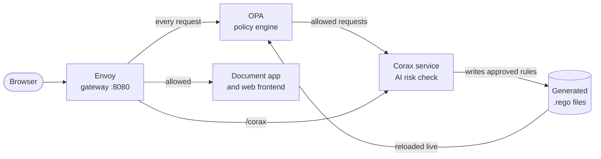

# Running the Demo

This guide walks through Corax protecting a document management application. It shows each capability in
isolation, the steps to reproduce it, and the result to expect. Start the stack first, as described in
[Getting Started](getting-started.md).

## Overview

### The Scenario

The demo models a company with 180 employees in 5 departments and 160 documents. All data is synthetic. The
document application has no access checks of its own, so every decision comes from Corax.

The company's access policy is deliberately simple. An employee may read a document in one of 2 cases:

- They work on one of the document's projects, or
- The document is public and belongs to their own department.

No other attribute, including the employee's role, grants access. This gap is what the demo exercises. Coordinators
and managers are routinely denied documents they legitimately need, and the policy has no way to express that
without a new rule.

### Architecture



Every request passes through Envoy, which asks OPA for a decision. OPA evaluates the Rego policy together with any
rules generated from approved appeals. When the policy allows a request, OPA asks the Corax service for a risk score
and denies the request if the score exceeds the threshold.

### What the Demo Shows

[2.1. Policy enforcement and resistance to object enumeration (BOLA)](#21-policy-enforcement)</br>
[2.2. The AI risk check on requests the policy allows](#22-the-ai-risk-check)</br>
[2.3. Turning one approval into a rule for comparable employees](#23-narrow-rules)</br>
[2.4. A second confirmation for rules with a large scope](#24-broad-rules)</br>
[2.5. Rejection with a note to the employee](#25-rejecting-a-request)</br>
[2.6. The administrator's pages](#26-administrator-pages)</br>
[2.7. Revocation and the audit trail](#27-revoking-access)</br>
[2.8. Granting access that nobody requested](#28-access-without-a-request)

### Ways to Run It

| Mode | Use it to |
|---|---|
| [1. Automated case log](#1-automated-case-log) | Verify every path in one run, with full technical detail |
| [2. The document application](#2-the-document-application) | Present Corax as users experience it |
| [3. The Corax console](#3-the-corax-console) | Inspect decisions and generated policy without the application |
| [4. Before and after comparison](#4-before-and-after-comparison) | Show the effect of the appeals on a fixed set of requests |

### Starting From a Clean State

Each mode writes requests, exceptions and rules. Reset the stack before each one, so results match this guide. A
reset takes a few seconds and keeps the prepared data and model.

```bash
docker compose -f deploy/docker-compose.yml down -v
docker compose -f deploy/docker-compose.yml up -d
```

## 1. Automated Case Log

```bash
docker compose -f deploy/docker-compose.yml run --rm demo
```

The command plays 57 cases against the application, in the order people would perform them, and records every
step of each one. That includes the HTTP requests, OPA's reason, the AI risk score, the candidate rule and its
scope, the Rego that was written, and the time OPA took to load it. Append `> demo-log.txt` to save the output.

| Part | Cases | Coverage |
|---|---|---|
| 1 | 1–8 | Regular reads: the employee's projects, public documents of their department, and BOLA attempts |
| 2 | 9–18 | Authentication failures: no token, a forged administrator token, an expired token, an unknown user, an unknown route, administrator routes, a wrong password |
| 3 | 19–30 | An intentionally broad preview rule, where the AI check decides. Typical documents pass, atypical ones are denied |
| 4 | 31–34 | Narrow rules, applied after one approval. A colleague who never asked gains access |
| 5 | 35–41 | Broad rules, which wait for the administrator to decline or to confirm the scope |
| 6 | 42–52 | Behavior after decisions: exceptions bypass the AI check and rules do not, plus repeated, rejected and redundant requests, and an appeal's history |
| 7 | 53–57 | Revocation of rules and of an exception |

Each case is printed in the following form:

```
Case 31: Engineering coordinator asks for an Engineering document (employee_E049, document_D057)
  expect  : generalizes: every coordinator reads the documents of their own department (small rule)
  witness : employee_E085 (Finance coordinator) never asks for access
  before  : GET /documents/document_D070 as employee_E085 -> 403 (denied by policy)
  request : POST /access-requests/document_D057 as employee_E049 -> 201 Created, request #2 pending
  status  : waits for the admin
  request : POST /admin/access-requests/2/approve as admin_01 -> 200 OK, granted
  corax   : POST /corax/appeals -> 201 Created, appeal-0001, exception written
  admin   : picks candidate #1: An employee may read a document when the employee and the document have the same department and the employee is a coordinator.
  request : POST /admin/access-requests/2/confirm {"candidate": 1}
  response: 200 OK, rule_applied
  indicators            value   limit
    users affected          4       5    ok
    new pairs              10      50    ok
    mean risk            0.11    0.50    ok
  tier    : SMALL -> applied with no second confirmation
  policy  : + appeal-0001-rule.rego
              allow if { ... "role_coordinator" in data.corax.graph[input.user.id]["holds"] }
  opa     : reloaded in 52 ms (no restart)
  after   : GET /documents/document_D070 as employee_E085 -> 200 (allowed, risk 0.0271)
```

The log refers to tiers as small and large, which the application presents as narrow and broad. A summary of all 57
cases closes the run, each marked `ok` or `FAIL`, and the command exits with code 1 if any case deviates from its
expectation. Cases fail on a stack that was used before, so reset it first.

The `demo` container reads the logs of Envoy and OPA through the Docker socket. Run it only on your own machine.

## 2. The Document Application

Open **http://localhost:8080** on a clean stack. The sign-in page lists the accounts used below, and each account
uses the demo password ([Settings](getting-started.md#settings)). Employee usernames are `e` followed by the employee
number, such as `e049`. The administrator is `admin_01`.

| Account | Name and role | Used in |
|---|---|---|
| `e040` | Hugo Koch, Engineer, Engineering | 2.1, 2.2, 2.4 |
| `e049` | Chloe Bakker, Coordinator, Engineering | 2.3 |
| `e085` | Oscar Weber, Coordinator, Finance | 2.3, 2.7 |
| `e001` / `e037` | Greta Lim, Manager, Sales / Iris Nugroho, Manager, Engineering | 2.3 |
| `e097` / `e169` | Tono Santoso, Data steward, Finance / Lotte Pratama, Data steward, HR | 2.3 |
| `e110` / `e002` | Eko Smit, Quality lead, Operations / Citra Nugroho, Quality lead, Sales | 2.3 |
| `e111` | Milan Setiawan, Security officer, Operations (EMEA) | 2.4 |
| `e003` | Ana Hartono, Analyst, Sales | 2.5 |
| `admin_01` | Corax administrator | 2.3 to 2.8 |

Employees see only the documents they can open, and the outcome of their own requests. Rules, their scope and the
AI's assessments are visible to the administrator only.

### 2.1 Policy Enforcement

**Objective:** Show that the policy decides every request, and that a denied request reveals nothing about the
document.

1. Sign in as **`e040`**. **Documents** lists only the documents this employee may open. Titles of other documents
   never appear. The search, the filters and **My projects** narrow the list further.
2. Open **D033**. The document opens, marked **Checked by Corax**, because `e040` works on one of its projects.
3. Replace the identifier in the address bar with **D130**, a confidential HR document. The page shows **No access**
   and **Denied by Corax**, without a title or any details.
4. Replace it with **D999**, which does not exist.

**Expected result:** Steps 3 and 4 produce identical pages. A user cannot distinguish a protected document from a
missing one, which prevents enumeration of document identifiers, the core of Broken Object Level Authorization
(BOLA).

### 2.2 The AI Risk Check

**Objective:** Show that the AI blocks requests the policy allows when they do not fit the user's normal access.

The preview rule is intentionally too broad. Every employee may preview every document, so the policy allows all
previews and the AI risk check becomes the deciding layer.

1. As **`e040`**, click **Preview** on **D040**.
2. Click **Preview** on **D133**.

**Expected result:** The summary of D040 appears, a typical request for an engineer. D133 is refused with **Corax
blocked this preview**, because it is unlike anything employees comparable to `e040` access.

### 2.3 Narrow Rules

**Objective:** Show that one approval produces a rule for comparable employees, and that a rule with a small scope
applies after a single confirmation.

A rule is **Narrow** when it reaches at most 5 people, adds at most 50 new accesses, and has a mean AI risk of at most
0.5. The four scenarios below share the same pattern. An employee requests a document of their own department that
belongs to none of their projects. Because only one employee per department holds each of these roles, the rule
Corax proposes is narrow.

| # | Requester | Document | Rule chosen by the administrator | Colleague who gains access |
|---|---|---|---|---|
| 1 | `e049` Engineering coordinator | **D057** | Coordinators read the documents of their own department | `e085` opens **D070** |
| 2 | `e001` Sales manager | **D011** | Managers read the documents of their own department | `e037` opens **D057** |
| 3 | `e097` Finance data steward | **D074** | Data stewards read the documents of their own department | `e169` opens **D137** |
| 4 | `e110` Operations quality lead | **D101** | Quality leads read the documents of their own department | `e002` opens **D003** |

**Scenario 1 in detail.**

1. **Baseline.** Sign in as **`e085`** and open `#/documents/document_D070`. The page shows **No access**. Sign out.
2. **Request.** Sign in as **`e049`** and open `#/documents/document_D057`, as if a colleague had shared the link.
   Enter a reason, such as "I coordinate all engineering projects", and click **Request access**. The page confirms
   that request `REQ-DOC-0001` is waiting for an administrator, and **My requests** lists it as pending.
3. **Approval.** Sign in as **`admin_01`**. **Requests** opens on **Pending**. Click the document title to review the
   request, then **Approve**. `e049` can now read D057. The request page lists the rules Corax proposes for
   comparable employees, ordered from the narrowest. For each rule it shows the **People** reached, the new
   **Grants**, the mean **Risk**, the **Reach** (narrow or broad) and the **Match** with similar past requests.
4. **Review and apply.** Click **Who gains** next to the coordinator rule to list the 4 employees and their
   documents, then click **Give access**. The rule is narrow and applies immediately.
5. **Effect.** Sign in as **`e085`**. **Documents** shows a notice that new documents were shared, and **Shared with
   me** lists **D070** marked **New**. The document opens, although `e085` never requested it. `e049` sees only that
   the request was approved, never the rule behind it.
6. **Record.** Sign in as **`admin_01`** and open **Access granted**. **Granted** lists the rule and the exception for
   `e049`, each with its approver, date, coverage and usage. **Activity** records Oscar Weber opening D070.

**Expected result:** One approval gives access to the requester and to every comparable employee, without further
requests. Scenarios 2 to 4 behave the same way. After scenario 2, for example, `e001` can also open D012, D017 and
D018, because the rule covers every Sales document rather than only the one requested.

### 2.4 Broad Rules

**Objective:** Show that a rule with a large scope requires an explicit second confirmation, and that the
administrator can limit an approval to one person.

A rule is **Broad** when it exceeds any of the limits above. The administrator sees this before choosing.

**Approving a single exception.**

1. Sign in as **`e040`**, open **D037**, a confidential document of another project, and click **Request access**.
2. Sign in as **`admin_01`**, open the pending request and click **Approve**. `e040` receives this one document as an
   exact exception. Every rule Corax proposes is broad.
3. Click **Only this person**.
4. Sign in as **`e040`**. **D037** opens, while another document of the same department, such as **D036**, remains
   denied.

**Approving a broad rule.**

1. Sign in as **`e111`**, a security officer in EMEA, open **D007** and click **Request access**. The request waits,
   because it is unusual and its rules are broad.
2. As **`admin_01`**, click **Approve**. **Who gains** next to each rule previews the people and documents it would
   open, without changing anything. Click **Give access** next to rule **#2**, "security officers read what is stored
   in their region".
3. Corax responds with **This reaches many people: please confirm**, showing 132 new accesses, a mean risk of 0.97,
   and the people affected. Click **Confirm and give access**.

**Expected result:** The broad rule applies only after the second confirmation. The AI risk check still evaluates
every access the rule opens, so unusual accesses remain denied.

Further requests that reach the administrator in the same way are `e125` (facility manager, Jakarta) for **D001**,
`e076` (auditor) for **D029**, `e171` (HR partner) for **D034** and `e147` (HR analyst) for **D001**.

### 2.5 Rejecting a Request

**Objective:** Show that a rejection reaches the employee with the administrator's explanation.

1. Sign in as **`e003`**, a Sales analyst, open **D073**, a Finance document, and click **Request access**.
2. As **`admin_01`**, click **Reject**, enter a note such as "Finance documents are restricted to Finance", and
   confirm.
3. Sign in as **`e003`** and open **My requests**.

**Expected result:** The request is listed as rejected together with the note, and D073 remains denied.

### 2.6 Administrator Pages

| Page | Purpose |
|---|---|
| **Requests** | All document and unit requests, organized in **Pending**, **Your decision** (approved, with a rule still to choose), **Decided** and **All**, and filtered by **Documents** or **Units** |
| **Suggested access** | Access the model expects an employee needs, which nobody has granted ([2.8](#28-access-without-a-request)) |
| **Give access** | The full catalog of documents and employees, for granting access without a request ([2.8](#28-access-without-a-request)) |
| **Access granted** | **Granted** lists every rule and exception in effect. **Activity** lists every use of that access |
| **Audit log** | Every administrator action as Corax recorded it, including the rule pattern and the three values that determined its tier (people reached, new accesses, mean risk) against their limits. Selecting an entry shows the raw record |

The administrator account cannot read documents. Opening one as `admin_01` is denied.

### 2.7 Revoking Access

**Objective:** Show that access granted through Corax can be withdrawn at once, and that the withdrawal is recorded.

On the request page, under **Decision**, two actions are available.

- **Revoke rule** withdraws the rule from every employee it reached. The requester keeps the original exception.
- **Revoke all** also withdraws the requester's exception.

**Access granted** offers the same action for each rule and exception. Every revocation requires confirmation. Corax
then deletes the corresponding `.rego` file, records who revoked it and when, and OPA reloads the policy within
milliseconds. Access granted by the application's own policy is not affected.

**Expected result:** After scenario 1 of [2.3](#23-narrow-rules), revoking the rule denies `e085` access to **D070**
again, the document disappears from **Shared with me**, and the **Audit log** records `rule_revoked`.

Deleting a rule file directly also revokes it, but without a record. **Access granted** then flags the entry as
removed outside Corax.

```bash
docker compose -f deploy/docker-compose.yml exec service rm /runtime/generated/appeal-0001-rule.rego
```

### 2.8 Access Without a Request

**Objective:** Show that access can originate from the administrator, since employees cannot request documents they
cannot see.

**Granting access directly.** As `admin_01`, open **Give access**. The **Documents** tab lists every document, and
**Members** shows who can already open each one. The **Employees** tab lists every employee, and **Permissions**
shows what each one can already open. Select a document title and choose an employee who cannot open it yet, or
select an employee to list only the documents they cannot open. After a reason is entered, the employee gains access
immediately, and Corax proposes rules for comparable employees as it does for an approved request.

**Suggested access.** **Suggested access** lists documents that most of an employee's 10 closest peers can open, and
that the employee would likely open without raising the risk score. The list can be filtered by department and
location. **Give access** follows the same flow as above, and **Dismiss** removes a suggestion. Employees never see
this list.

**Requests for a unit.** An employee who needs documents from another department but cannot name them opens **My
requests**, selects **Ask for a unit**, chooses the department from a fixed list and describes the need. The request
appears to the administrator as `REQ-UNIT-0001`. **Decide** lists that department's documents the employee cannot open
yet, ranked by Corax with their **Peer access** and **Risk score**, and warns when no comparable employee opens any of
them. The administrator selects documents and clicks **Grant selected**. Each becomes an approved request under
**Your decision**. The employee learns how many documents were shared, never which other documents the department
holds.

## 3. The Corax Console

**http://localhost:8090** exposes Corax without the document application. It acts as the identity provider, so you
choose the identity and the console signs the token.

| Section | Purpose |
|---|---|
| **Sign in as** | Choose an administrator or an employee, grouped by role |
| **Read a document** | Send a request through Envoy and OPA, and see the decision, OPA's reason and the AI risk score |
| **Approve an appeal** | As the administrator, apply the exact exception, then choose a candidate rule, confirm a broad scope, or keep only the exception |
| **Policy added on top of the application rules** and **Corax activity** | Inspect the generated Rego files and the history of every appeal |

## 4. Before and After Comparison

On a clean stack:

```bash
docker compose -f deploy/docker-compose.yml run --rm demo scripts/demo_gateway.py run --gateway http://envoy:8080
```

The script sends 26 named requests, resolves ten appeals as the administrator through Corax's API, each with the rule
it expects, and sends the same requests again. It prints each request's AI risk score and its result before and after
the appeals.

**Expected result:** Appellants and their colleagues move from 403 to 200. BOLA attempts remain 403. Accesses that a
new rule opens but the AI considers unusual also remain 403.
