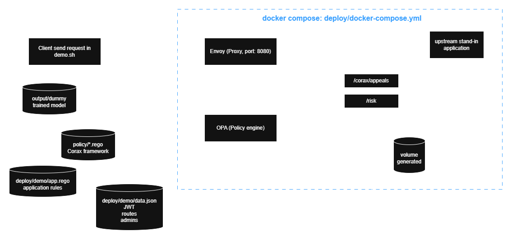

# Getting started

Install Corax, create the dummy data and train the model once. The trained model is what the end-to-end
demo runs on, and the same model lets you try Corax locally without Docker. Run every command from the
repository root.

## 1. Install

Python 3.11 or newer.

```bash
python -m venv .venv
```

Activate it: `.venv\Scripts\Activate.ps1` (PowerShell), `source .venv/Scripts/activate` (Git Bash) or
`source .venv/bin/activate` (Linux, macOS). Then:

```bash
pip install torch --index-url https://download.pytorch.org/whl/cpu
pip install -r hgnn/requirements.txt -r service/requirements.txt -r requirements-dev.txt
```

Pick the CUDA build of torch instead of `cpu` if you have a GPU. The dummy data trains in seconds on CPU.

## 2. Create the dummy data and train once

```bash
python scripts/prepare/make_dummy.py output/dummy-data
python -m hgnn --data output/dummy-data --target-relation accessed --out output/dummy --learning-rate 0.01 --patience 50
```

The dummy data is a small graph of users, objects and how they are related. Its `accessed` edges are the
access the current policy allows. Training holds out 10% of those edges as a test set the model never
sees. The result is the model folder `output/dummy` ([Data and files](how-it-works.md#data-and-files)).

## 3. End-to-end demo with Docker

Real requests through Envoy, OPA and the service. This shows the deny-only AI check on live requests and
OPA loading a rule from an appeal without a restart.

<!-- TODO image: client → Envoy :8080 → OPA → service, Envoy → application, Envoy /corax/* → service, service → rules → OPA -->


| Container | Role | Port |
|---|---|---|
| `envoy` | Gateway: asks OPA about every request, forwards the allowed ones | `8080`, the only one published |
| `opa` | Policy engine: Corax's framework, the application's rules and the rules from appeals | internal |
| `service` | `/risk` for OPA, `/corax/appeals` for admins | internal |
| `upstream` | Stand-in for the protected application (answers every allowed request) | internal |

The service and OPA share a volume for the rules from appeals, and OPA watches it (`--watch`), so a new
rule is live without a restart. Both run inside Linux, so the file events reach OPA. A folder on Windows
bind-mounted into a container often does not deliver them.

### Run

Needs Docker and the trained model from step 2 (`output/dummy`).

```bash
docker compose -f deploy/docker-compose.yml up --build -d
```

```bash
bash deploy/demo/demo.sh
```

`demo.sh` needs only `docker` and `curl`. It signs the demo tokens and reads JSON with the Python inside
the service container. For your own requests, `scripts/make_token.py --sub <user>` prints a token.

The script starts from no appeals and stops if rules from an earlier run are still loaded. To start
again, remove the volumes:

```bash
docker compose -f deploy/docker-compose.yml down -v
```

### The demo application

`deploy/demo/app.rego` holds the application's own rules, evaluated by Corax's framework in `policy/`:

| Route | Rule |
|---|---|
| `GET /students/:id/grades` | Allowed when the user is directly related to the object (teaches or advises them) |
| `GET /students/:id/profile` | **Deliberately too broad**: every staff user |

### What the demo shows

The script prints one block per case, in three sections:

| Case | What happens | Expected |
|---|---|---|
| **A. Denied by policy** | | |
| 1 | A user requests an object they have no relation to | **403**, `denied by policy`, the AI is not asked |
| **B. Allowed by policy, checked by Corax** | | |
| 2 | Through the over-broad rule, a user requests an object that fits their access pattern | **200**, risk far below the threshold |
| 3 | Through the same rule, the same user requests an object that does not fit | **403**, `high AI risk`: the policy allows it, the AI denies it |
| **C. Appeals** | | |
| 4 (small) | The admin accepts one user's appeal and one of the proposed rules. Corax computes it as small | Applied at once. Another user in the same situation, who never appealed, goes from **403** to **200** |
| 5 (large, declined) | The admin accepts an appeal and one of the proposed rules. Corax computes it as large | **409**, waits for a second confirmation. The admin declines and keeps only the exact exception, so other pairs stay **403** |
| 6 (large, approved) | Another appeal whose chosen rule Corax computes as large | **409**, then the admin confirms with `acknowledge_scope`. Another user who never appealed goes from **403** to **200** |
| 7 (revoke) | The rule file of case 6 is deleted | OPA reloads and that user is **403** again. This is how a rule from an appeal is rolled back |

For every request the script shows the response and OPA's reason, and in section B the threshold and
the AI risk. For every appeal it shows the three tier indicators against their limits, the tier, the
`allow` block of the Rego file that was written, and how long OPA took to load it. Case 4 looks like
this (the ids come from the dummy data):

```
Case 4 (small): lecturer_head_P0 appeals to access student_P0_05, then the admin accepts
  before  : GET /students/student_P2_14/grades as lecturer_head_P2 -> 403 (denied by policy)
  request : POST /corax/appeals -> 201 Created, appeal-0001, exception written
            candidate #2: user.member_of = object.member_of AND user holds position_head_of_program
  request : POST /corax/appeals/appeal-0001/confirm {"candidate": 2}
  response: 200 OK, rule_applied
  indicators             value   limit
    users affected     6 (20%)     40%    ok
    new pairs               45      50    ok
    mean risk             0.25    0.50    ok
  tier    : SMALL -> applied without a second confirmation
  policy  : + appeal-0001-rule.rego
              allow if {
                input.action == "read_grades"
                some n1 in data.corax.graph[input.user.id]["member_of"]
                n1 in data.corax.graph[input.resource.id]["member_of"]
                "position_head_of_program" in data.corax.graph[input.user.id]["holds"]
              }
  opa     : reloaded in 15 ms (no restart)
  after   : GET /students/student_P2_14/grades as lecturer_head_P2 -> 200 (allowed, risk 0.2195)
```

The ids in `demo.sh` fit `output/dummy` trained as in step 2. Another model may give other risks, so
check a pair first with `scripts/similar_cases.py` or `scripts/demo_risk.py`.

To check the demo application's rules without Docker (the service is mocked):

```bash
opa test policy/authz.rego policy/request.rego deploy/demo
```

## 4. Without Docker

### The AI predicts access it has never seen

```bash
python scripts/demo_risk.py --model-dir output/dummy
```

The script scores pairs from the test split and puts the true answer next to the AI's:

| Row | Meaning | The AI should |
|---|---|---|
| **allowed** | A real access the model never saw | Let it pass |
| **not allowed** | A random pair without access | Deny it |
| **peer has it** | A pair without access, but a peer of the user has the object. It looks normal, the hardest case | Deny it |

```
threshold 0.992; all held-out pairs, none seen during training:
  allowed      49/49 let through (100%)
  not allowed  85/98 denied (87%)
  peer has it  32/47 denied (68%)
```

A pair is denied when its risk is above the threshold, the same rule `/risk` uses. In the real flow the AI
only sees requests the policy already allowed. The "not allowed" rows show what it would catch if a
wrong or over-broad rule let such a request through. A miss there means the AI adds no deny and the
policy decision stands.

### Appeals, end to end with OPA

Needs the [OPA binary](https://www.openpolicyagent.org/docs/latest/#running-opa).

```bash
python scripts/demo_appeal.py --model-dir output/dummy --opa path/to/opa
```

The script runs the same code as the `/corax/appeals` endpoints (without HTTP and JWT), writes the Rego
files to a temporary folder (`--out` keeps them), then lets OPA decide on them.

In every appeal the admin accepts the request, and Corax proposes candidate rules. The admin accepts one
of them, by what it says and not by its size, or none. Corax then computes the tier of the accepted rule
from its share of users, new pairs and mean risk. The script plays the admin:

| Appeal | Rule the admin accepts | Tier (computed by Corax) | Result |
|---|---|---|---|
| 1 | Users with the appellant's role may access objects of their own group | **Small** | Written at once. Another user in the same situation, who never appealed, is allowed |
| 2 | Everyone in a group may access objects of that group | **Large** | 409 response code, nothing written until the admin confirms again with `acknowledge_scope` |
| 3 | None, the appeal is a one-off | | **Exception only**: just that one pair is opened |

To look at a single appeal with all its similar cases and candidates, without writing anything:

```bash
python scripts/similar_cases.py --model-dir output/dummy --user <user> --object <object> --pick 1
```

How appeals work: [Appeal](how-it-works.md#appeal-path).

### The risk endpoint as OPA calls it

```bash
CORAX_MODEL_DIR=output/dummy uvicorn main:app --app-dir service --port 8000
```

```bash
curl -X POST localhost:8000/risk -H "Content-Type: application/json" -d '{"user": "<user>", "object": "<object>"}'
```

```json
{"risk": 0.99993, "high_risk": true, "threshold": 0.992, "reason": null}
```

User and object ids are listed in `output/dummy/node_ids.json`. `/risk` uses the embeddings of the whole
graph, so its numbers differ slightly from `demo_risk.py`, which recomputes them without the test edges.

## Larger datasets

The same flow (prepare, `python -m hgnn`, evaluate) runs on the Amazon Access Samples dataset and the
Xu & Stoller ABAC policies. Read [scripts](reference.md#scripts) and [evaluation](evaluation.md).
