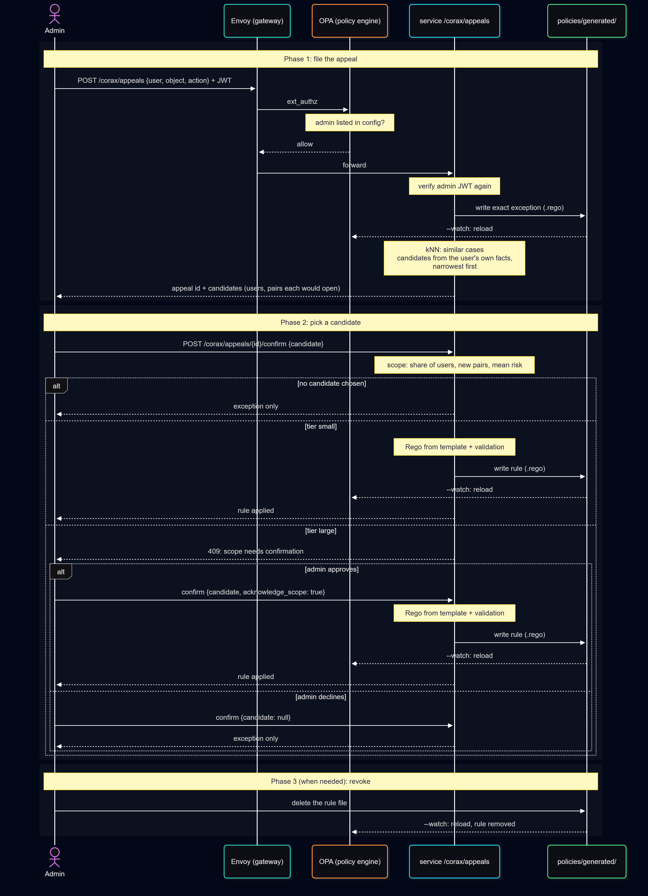

# How Corax works

Corax sits in front of an application and decides every request to it. It has an online part, which
handles requests and appeals, and an offline part, which trains the graph model the online part reads.

Three principles shape it (details in [security](security.md)): policy code is the only source of allow
decisions, the AI can only turn an allow into a deny, and every rule from an appeal is validated, logged
and revoked by deleting its file.

## Components


| Component | Does | Reads | Writes | Reachable from |
|---|---|---|---|---|
| Envoy | Proxy in front of the application, asks OPA about every request (`ext_authz`) | | | Clients |
| OPA | Policy engine: JWT, route, policy, AI risk call | `policy/`, the application's rules, `policies/generated/`, `data.json`, `graph.json` | | Envoy only |
| `service` | `/risk` for OPA, `/corax/appeals` for admins | Model folder, `data.json` | `policies/generated/`, appeal records | OPA and Envoy only |
| `hgnn` | Offline job: trains the model and exports it (`python -m hgnn`) | `nodes.csv`, `edges.csv` | Model folder | Nobody |

## Request path


1. **Identity and route:** OPA verifies the JWT (the user is its `sub`) and matches the method and path to a route. The object id comes only from the URL path, never from the query string or body.
2. **Policy:** The application's rules and the rules from appeals decide. A deny ends here with 403.
3. **Risk check:** Only after an allow, OPA asks the service for the risk of this (user, object) pair. Read [risk score](#risk-score).
4. **Decision:** The request goes through unless the risk is above the threshold.

The deny-only rule is written out in Rego, so it can be audited:

```rego
allow if {
	policy_allow
	not ai_high_risk
}
```

Listed admins reach the Corax admin routes without the risk check, and the exact pair an admin approved
in an appeal skips it too. Read [policy](reference.md#policy).

| Failure | Result |
|---|---|
| Missing, expired or forged token | 403 response code, `missing or invalid token` |
| Method and path match no route | 403 response code, `no matching route` |
| OPA unreachable | Envoy denies everything (`failure_mode_allow: false`) |
| Service down or slower than `ai.timeout` | The policy decision stands, `allowed without AI check` |
| User or object unknown to the model (added after the last training) | The policy decision stands, `allowed without AI check` |

## Risk score

### Background

The model is Corax's own implementation of the heterogeneous graph method in [[1]](evaluation.md#references), with the architecture and hyperparameters described there. Users, objects and everything that connects them (departments, roles, projects, managers) are nodes of one typed graph. Past access is one edge type, and the model learns to predict it (link prediction).

### What Corax adds

- **The decoder is the risk score.** No separate classifier is trained on top of the embeddings. The
  dot product the model was trained with gives the risk of user *u* reading object *o*:

  $$
  \mathrm{risk}(u, o) = 1 - \sigma\left(\mathbf{h}_u^{T} \mathbf{h}_o\right),
  \qquad \sigma(x) = \frac{1}{1 + e^{-x}}
  $$

  Applications rarely have labeled examples of access that should be denied, and this needs none.
- **The model only checks, after the policy.** It runs once the policy has already allowed a request
  and can only turn that allow into a deny, so its mistakes can cost a false deny but never a false allow.
- **A calibrated threshold.** Set so that 99% of real access in the validation split passes.
- **Hard negatives** (optional, `--hard-negative-ratio`): some training negatives are objects a peer of
  the user has, the realistic case of a misconfigured rule. On Amazon they raise the AUC on such pairs
  from 0.675 to 0.897 ([Evaluation](evaluation.md)).
- **A held-out test split** (80%/10%/10%), so reported numbers come from edges never used for training
  or calibration.
- **The same embeddings find similar cases** (kNN) for [appeals](#appeal-path).

### Graph

Corax is not tied to one domain. It reads typed nodes and typed edges from two CSV files
([data format](reference.md#data-format)). One edge type is the target. For the example used in these
docs, a company whose employees read reports:

| Amazon dataset | Example company |
|---|---|
| `user` | `employee` (e.g. `alice`) |
| `resource` | `report` (the object being accessed, e.g. `report_105`) |
| `department` | `department` |
| `title` | `role` (`role_manager`, `role_staff`) |
| `has_potential_access` | `accessed` (employee → report, from allowed requests only) |

A role is a node, not an attribute, so the graph contains the path `employee → role → employee`
("both are managers"). This is what lets the model see that two managers are similar.

### Model and training

| Item | Value |
|---|---|
| Node input | Learnable `nn.Embedding` per node |
| Encoder | 2 × `SAGEConv` with ReLU, converted with `to_hetero()`. `ToUndirected()` adds reverse edges |
| Decoder | Dot product `h_user · h_object` |
| Loss | Binary cross-entropy with logits, 2 negatives per positive |
| Split | `RandomLinkSplit` 80 / 10 / 10: train, validation (early stopping, threshold), test (evaluation only) |
| Optimizer | Adam, learning rate 0.001, patience 10, embedding size 64 |
| Hard negatives | Optional share of negatives taken from a peer's objects (`--hard-negative-ratio`, 0.5 on Amazon) |

Full-batch training: the graphs fit in memory, and `LinkNeighborLoader` needs `pyg-lib`, which is hard
to install on Windows.

Node inputs are learned per node (transductive). A new user or object only gets an embedding after
retraining. Until then `/risk` returns no score and the policy decision stands.

### From embeddings to risk

```
p     = σ(h_user · h_object)     how likely this user is to be connected to this object
risk  = 1 − p
deny  when risk > threshold
```

The dot product is used, not cosine, because the model was trained with it.

**Threshold.** The risk below which 99% of the real access in the validation split falls
(`--target-pass-rate 0.99`, about 1% false deny). It is an operating choice.
`scripts/evaluate/evaluate_hgnn.py` prints false deny and detection on the test split for 95%, 98%,
99%, 99.5% and 99.9%. The value is stored in `metadata.json` and can be overridden with
`AI_RISK_THRESHOLD`. Scores are deterministic, so a legitimate pair that is denied is denied every
time and can be resolved once through an appeal.

An employee who just joined a project has no access history yet, but is connected to the project's
reports through `works_on` and `belongs_to`, so the score stays reasonable.

## Appeal path

A user is denied, an admin decides they should have access. The appellant gets an exact exception at
once, then Corax looks for other people in the same situation and proposes a rule for all of them. Every step is deterministic and can be replayed.



**Phase 1: the admin files the appeal**, `POST /corax/appeals`.

1. The exact exception for the appellant is written at once.
2. kNN finds the most similar pairs that have no access yet.
3. Candidate rules are built from the appellant's own facts and returned, narrowest first, with the users
   and pairs each one would open.

**Phase 2: the admin accepts one of the proposed rules**, `POST /corax/appeals/{id}/confirm`.

4. The scope of the chosen rule is computed: share of users, new pairs, mean risk.
5. Tier: a small rule continues. A large one returns 409 until the admin confirms again with
   `acknowledge_scope`. The admin can also keep only the exception.
6. The rule is written as Rego from a fixed template and validated (syntax, whitelist, the application's
   tests, equivalence with the pattern). A rule that fails is not written.
7. The file is written atomically to `policies/generated/`. OPA, which watches the folder, loads it within
   milliseconds.

**Phase 3 (optional): revoke.** Deleting the rule's file removes it, and OPA reloads the same way.

Policy files change only on disk. OPA's REST API is never used for writes and is not exposed.

| Written | Where | When |
|---|---|---|
| `<id>-exception.rego` (package `app.exceptions`) | `policies/generated/` | Phase 1 |
| `<id>-rule.rego` (package `app.generated`) | `policies/generated/` | Phase 2, if the admin accepts a rule |
| Appeal record with its history (audit log) | `appeals/` | Every step |

The steps in detail use this example (illustrative): `alice`, the manager of the sales department, is
denied `report_105`, a report of that department, because no rule covers managers yet.

### 1. Exact exception

`<id>-exception.rego` in package `app.exceptions`, written as soon as the appeal is created:

```rego
allow if {
	input.user.id == "alice"
	input.resource.id == "report_105"
	input.action == "read_report"
}
```

The admin reviewed this exact pair, so it skips the AI risk check.

### 2. Similar cases (kNN)

The most similar (user, object) pairs that have no access yet. Similarity of a pair is the mean of the
cosine similarity of the users' embeddings and of the objects' embeddings. At most 2 pairs per user
(`max_per_user`), so one user cannot fill the list. The cases are evidence for the admin. They do not
decide the rule.

### 3. Candidate patterns

Candidates are built only from the appellant's own facts in the graph, as conjunctions of up to two
predicates:

| Kind | Reads as | Example |
|---|---|---|
| `user_has` | user has a value | `user holds role_manager` |
| `object_has` | object has a value | `object type invoice` |
| `shared` | user and object share a node | `user.member_of = object.member_of` |
| `direct` | user is linked to the object | `user owns object` |
| `object_is` | one specific object (systems in Amazon, off by default) | `object is resource_42` |

**Too specific values are skipped**: a value both the user and the object have (the `shared` candidate
covers it for every value) and a value of an attribute with several values (one of the projects a
user works on). Otherwise one slice per value would rank above the general rule, because it opens fewer
pairs.

Candidates are ordered **narrowest first**: fewest new pairs, then fewest users, then fewest
predicates, then highest kNN support. For each one the admin sees how many users and pairs it opens
and what share of the similar cases it covers:

```
  #  users      pairs   kNN  pattern
  1      3         12   20%  user.member_of = object.member_of AND user works_on project_sales_1
  2      6         45   10%  user.member_of = object.member_of AND user holds role_manager
  4     28        105   30%  user.member_of = object.member_of
```

The admin accepts one (here #2, "a manager may read the reports of their own department") or none (`exception_only`).

### 4. Tier

Computed from the exact pairs the chosen pattern opens:

| Input | Limit (environment variable, default) |
|---|---|
| Share of all users who get new access | `AUTO_APPLY_MAX_USER_SHARE`, 0.4 |
| New (user, object) pairs | `AUTO_APPLY_MAX_PAIRS`, 50 |
| Mean risk of the new pairs | `AUTO_APPLY_MAX_MEAN_RISK`, 0.5 |

**Small** (all within limits): applied, logged. **Large** (any limit exceeded): the confirm call returns
409 with the scope until the admin repeats it with `acknowledge_scope: true`.

No regulation fixes these numbers. ISO 27001, NIST 800-53, PCI DSS and SOC 2 require that access grants
are approved and logged, not a size limit, so they are set to the organization's risk appetite.
`AUTO_APPLY_MAX_USER_SHARE=0` makes every rule wait for an admin.

### 5. Rego

Written from a fixed template into package `app.generated`, with the pattern, scope and tier recorded
as metadata:

```rego
# METADATA
# title: "appeal-0001"
# description: "user.member_of = object.member_of AND user holds role_manager"
# custom:
#   appeal_id: "appeal-0001"
#   users: 6
#   pairs: 45
#   tier: "small"
allow if {
	input.action == "read_report"
	some n1 in data.corax.graph[input.user.id]["member_of"]
	n1 in data.corax.graph[input.resource.id]["member_of"]
	"role_manager" in data.corax.graph[input.user.id]["holds"]
}
```

`data.corax.graph` is `graph.json`, written by `python -m hgnn` and loaded by OPA.

### 6. Validation

Any failure rejects the rule (422) and nothing is written:

1. **Syntax**: `opa check --strict`.
2. **Whitelist**: the AST may only define `allow` in `app.generated` or `app.exceptions`, read only
   `input.action`, `input.user.id`, `input.resource.id` and `data.corax.graph`, and use only equality
   and membership.
3. **Application tests**: `opa test` on the application's policy folder still passes (`POLICY_DIR`).
4. **Equivalence**: OPA gives exactly the decisions of the pattern on the appealed pair, the pairs it
   opens and 500 random pairs.

The file is then written atomically, so OPA never loads half a file. Revoking a rule means deleting
its file.

## Data and files

| File | Written by | Read by | Content |
|---|---|---|---|
| `embeddings.npz`, `node_ids.json` | `hgnn` | service | One vector per node |
| `metadata.json` | `hgnn` | service | Settings, metrics, risk threshold |
| `graph.json` | `hgnn` | service, OPA (`data.corax.graph`) | Facts of every node: department, role, … |
| `access.json` | `hgnn` | service | Access history, to skip pairs that already have access |
| `data.json` | Operator | OPA, service | JWT settings, routes, AI address, admin list ([Policy](reference.md#policy)) |
| `policies/generated/*.rego` | service | OPA | Rules and exceptions from appeals |
| `appeals/*.json` | service | service, admins | Appeal records |

After retraining, the new model folder replaces the old one. The service reads it on restart, and OPA
needs the new `graph.json` in its data folder.

## Trust boundaries

- **Only Envoy is reachable from outside:** OPA, the service and the application sit on the internal
  network.
- **`/risk` has no authentication:** it must stay reachable by OPA only.
- **Appeals are checked twice:** OPA lets only `config.admin.users` reach `/corax/*`, and the service
  verifies the admin's JWT again with the same key and admin list, so reaching the service directly does not bypass the check.
- **No write API for policies:** Rules reach OPA only as files in a folder the service writes.

## Deployment

`deploy/docker-compose.yml` runs Envoy, OPA and the service in front of a stand-in API. The service and
OPA share the `policies/generated` volume, so OPA sees new files at once. See the
[demo](getting-started.md#3-end-to-end-demo-with-docker). What production still needs
(identity provider keys, TLS between components, health checks) is in [future work](security.md#future-work).
